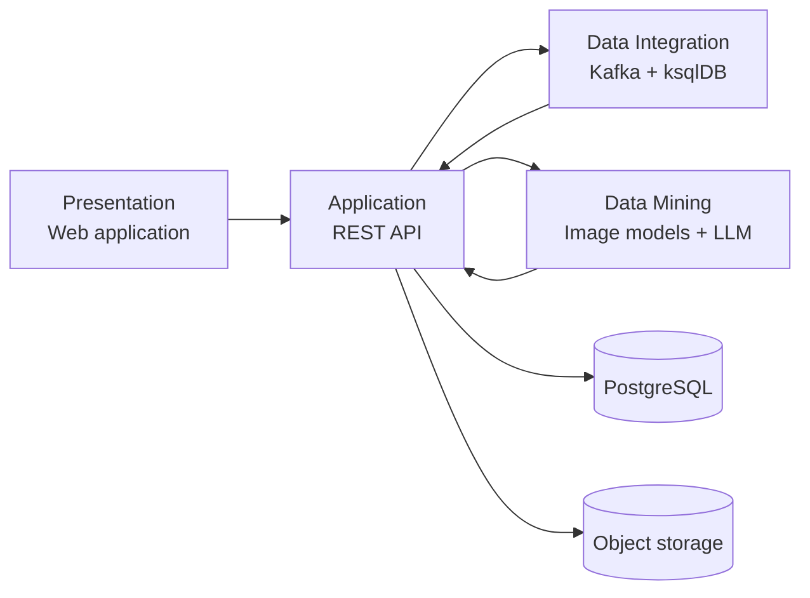

# PlantGuard

Проект интеллектуальной системы поддержки принятия решений для распознавания комнатных растений, диагностики и мониторинга их состояния по фотографиям, текстовым описаниям и истории ухода.

> **Статус:** технический прототип. Сейчас реализованы форма наблюдения, проверка входных данных, контракты событий и изолированная политика оценки. Хранение фотографий, модели, публикация в Kafka и полноценная история растения ещё не подключены.

## Авторы

- Вышенская Екатерина
- Верхоланцева Екатерина
- группа РИС-26-1м

## Идея проекта

PlantGuard разрабатывается как инструмент, который поможет владельцу растения принять обоснованное решение об уходе. В целевом сценарии пользователь фотографирует растение, описывает симптомы и при необходимости добавляет данные об уходе и условиях содержания. Система должна:

1. предлагать наиболее вероятные виды растения;
2. определять видимые признаки неблагополучия;
3. сопоставлять фотографию с описанием, условиями содержания и историей ухода;
4. формировать объяснимую оценку состояния и рекомендации;
5. предлагать повторить наблюдение и сравнивать состояние во времени.

Ключевая идея проекта — повторная оценка одного и того же растения. При новом наблюдении PlantGuard должен учитывать предыдущие фотографии и события ухода, отмечать изменения и сообщать, достаточно ли данных для достоверного сравнения.

Целевой формат результата:

> Вероятнее всего, это монстера деликатесная — 91%. На двух последовательных снимках увеличилась область пожелтения выбранного листа. После прошлого наблюдения был отмечен полив. Причину пока нельзя определить: проверьте влажность субстрата и добавьте снимок нижней стороны листа.

Планируется, что PlantGuard будет показывать предположения и уровень уверенности модели. Если данных недостаточно, система должна запрашивать уточнение или предлагать выбрать вид растения вручную.

## Архитектура

Целевая архитектура проекта разделена на четыре слоя:



- **Presentation** — загрузка фотографий, описание симптомов, карточки растений, история наблюдений и сравнение снимков.
- **Application** — пользователи, растения, наблюдения, правила принятия решений и объединение результатов анализа.
- **Data Integration** — события наблюдений и ухода, показатели среды, потоковые агрегаты и предупреждения.
- **Data Mining** — распознавание вида, анализ визуальных признаков и изменений, разбор текста и формирование объяснений.

Подробное описание компонентов находится в [docs/architecture.md](docs/architecture.md).

## Структура репозитория

```text
apps/web/                  веб-интерфейс
services/api/              прикладной REST API
services/mining/           интерфейсы моделей и правила оценки
contracts/events/          версионируемые схемы событий
data-integration/ksqldb/   потоковые запросы ksqlDB
tests/                     проверки архитектуры и контрактов
docs/                      проектная документация
```

## Локальный запуск прототипа

Требования:

- Docker с поддержкой Compose;
- Node.js 22 или новее;
- Python 3.11 или новее.

```bash
cp .env.example .env
docker compose up --build
```

В отдельном терминале после готовности ksqlDB:

```bash
make ksql-init
```

После запуска:

- веб-приложение: `http://localhost:5173`;
- API и OpenAPI: `http://localhost:8000/docs`;
- ksqlDB REST API: `http://localhost:8088`.

Полный запуск Compose с чистого окружения запланирован на шаг 3. Наличие конфигурации в репозитории пока не считается подтверждением работоспособности всего контура.

## Тестирование

```bash
make bootstrap
make test
```

Сейчас тестами покрыты:

- отображение формы и обязательность фотографии;
- проверка формата, содержимого и отдельных числовых полей запроса;
- основные ветви изолированной политики оценки;
- соответствие примеров JSON-схемам событий.

Интеграционные тесты Kafka/ksqlDB, реальные модели и сквозной сценарий относятся к следующим этапам [плана реализации](docs/roadmap.md).

## Состояние проекта

Проект находится на этапе формирования технической основы. API пока проверяет запрос и возвращает временный идентификатор, но не сохраняет фотографию или наблюдение. Границы первой версии описаны в [docs/mvp.md](docs/mvp.md).

Последовательность работ и критерии завершения каждого этапа приведены в [плане реализации](docs/roadmap.md).

PlantGuard не заменяет консультацию специалиста. Рекомендации системы должны быть проверяемыми, объяснимыми и безопасными для растения.
