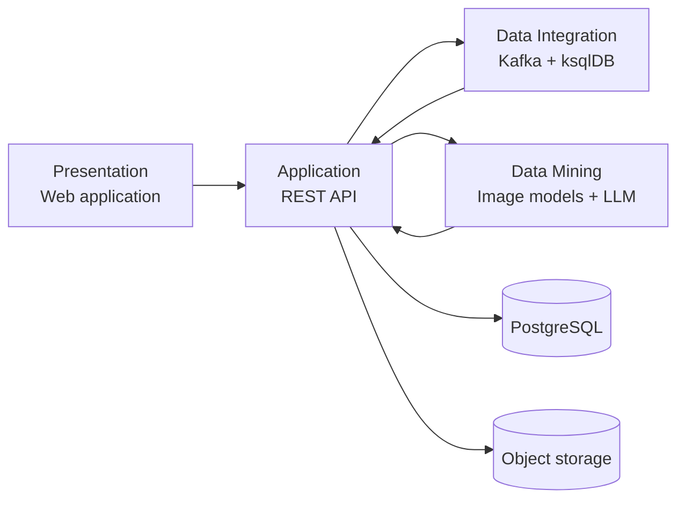

# PlantGuard

Проект интеллектуальной системы поддержки принятия решений для распознавания комнатных растений, диагностики и мониторинга их состояния по фотографиям, текстовым описаниям и истории ухода.

> **Статус:** локально воспроизводимая release-candidate версия. Реализован полный веб-сценарий от регистрации и повторного входа до карточки растения, загрузки наблюдения, оценки состояния, подтверждения вида, фотопрогресса, истории ухода и динамики. Production-контур с HTTPS, метриками и резервным копированием подготовлен; внешними условиями публичного релиза остаются доступ к выбранному серверу и достижение целевых метрик моделей на независимых датасетах.

## Авторы

- Вышенская Екатерина
- Верхоланцева Екатерина
- группа РИС-26-1м

## Идея проекта

PlantGuard разрабатывается как инструмент, который поможет владельцу растения принять обоснованное решение об уходе. В целевом сценарии пользователь фотографирует растение, описывает симптомы и при необходимости добавляет данные об уходе и условиях содержания. Система должна:

1. предлагать наиболее вероятные виды растения;
2. определять видимые признаки неблагополучия;
3. сопоставлять фотографию с описанием, условиями содержания и историей ухода;
4. формировать объяснимую оценку состояния и рекомендации;
5. предлагать повторить наблюдение и сравнивать состояние во времени.

Ключевая идея проекта — повторная оценка одного и того же растения. При новом наблюдении PlantGuard должен учитывать предыдущие фотографии и события ухода, отмечать изменения и сообщать, достаточно ли данных для достоверного сравнения.

Целевой формат результата:

> Вероятнее всего, это монстера деликатесная — 91%. На двух последовательных снимках увеличилась область пожелтения выбранного листа. После прошлого наблюдения был отмечен полив. Причину пока нельзя определить: проверьте влажность субстрата и добавьте снимок нижней стороны листа.

Планируется, что PlantGuard будет показывать предположения и уровень уверенности модели. Если данных недостаточно, система должна запрашивать уточнение или предлагать выбрать вид растения вручную.

### Показания среды и уведомления

В карточке растения откройте «Показания среды», введите температуру или влажность и нажмите «Сохранить показания». На графике можно переключаться между двумя показателями. Если значение вышло за порог потокового правила, откройте «Уведомления» в боковом или мобильном меню. Там видны растение, причина, время и серьёзность предупреждения. Отметка о прочтении обновляет счётчик.

## Архитектура

Целевая архитектура проекта разделена на четыре слоя:



- **Presentation** — загрузка фотографий, описание симптомов, карточки растений, история наблюдений и сравнение снимков.
- **Application** — пользователи, растения, наблюдения, правила принятия решений и объединение результатов анализа.
- **Data Integration** — события наблюдений и ухода, показатели среды, потоковые агрегаты и предупреждения.
- **Data Mining** — гибридное распознавание вида по широкому каталогу с локальным резервом, анализ визуальных признаков и изменений, разбор текста и формирование объяснений.

Подробное описание компонентов находится в [архитектуре](docs/architecture.md), навигация по всем материалам — в [оглавлении документации](docs/README.md).

## Структура репозитория

```text
apps/web/                  веб-интерфейс
services/api/              прикладной REST API
services/mining/           интерфейсы моделей и правила оценки
contracts/events/          версионируемые схемы событий
data-integration/ksqldb/   потоковые запросы ksqlDB
datasets/plantguard-v1/    лицензированный реестр изображений и отчёт аудита
tests/                     проверки архитектуры и контрактов
docs/                      проектная документация
```

## Локальный запуск

Требования:

- Docker с поддержкой Compose;
- Node.js 22 или новее;
- Python 3.11 или новее.

```bash
cp .env.example .env
docker compose up --build --detach --wait
```

После готовности сервисов примените схему базы данных, потоковую схему и проверьте контур:

```bash
make db-upgrade
make ksql-init
make smoke
```

После запуска:

- веб-приложение: `http://localhost:5173`;
- API и OpenAPI: `http://localhost:8000/docs`;
- ksqlDB REST API: `http://localhost:8088`.

При первом открытии создайте профиль с паролем не короче 10 символов. Повторный вход доступен на стартовом экране; успешный вход заменяет прежний bearer token. После обновления уже существующего окружения обязательно выполните `make db-upgrade` до проверки авторизации.

Для распознавания по широкому каталогу создайте бесплатный API-ключ на [my.plantnet.org](https://my.plantnet.org/) и укажите `PLANTGUARD_PLANTNET_API_KEY` в `.env`. Без ключа приложение продолжает работать на встроенной демонстрационной модели. Устройство интеграции, порог уверенности и правила приватности описаны в [документации распознавания](docs/plant-identification.md).

Веб-интерфейс, API и outbox worker собираются в единый собственный образ `plantguard-app`: FastAPI обслуживает REST-маршруты и готовую статическую сборку интерфейса, а worker публикует сохранённые события. PostgreSQL, Kafka и ksqlDB остаются отдельными инфраструктурными сервисами. Постоянные данные проекта находятся только в именованных томах `plantguard_postgres-data` и `plantguard_photo-data`.

Команда `make smoke` проверяет доступность веб-приложения и API, загрузку, чтение и удаление тестовой фотографии, состояние ksqlDB, а также наличие ожидаемых потоков и таблиц. Остановить окружение можно командой `make down`.

## Production

Для Linux VPS подготовлен отдельный контур с Caddy, автоматическим HTTPS, закрытой внутренней сетью, readiness-проверкой, Prometheus-совместимыми метриками и резервным копированием PostgreSQL и фотографий. Пошаговая инструкция для Amnesia Host и другого VPS находится в [docs/deployment.md](docs/deployment.md). Секреты хранятся только в локальном `deploy/.env.production` или GitHub Environment.

## Тестирование

```bash
make bootstrap
make test
make test-coverage
make test-migrations
make test-streams
```

Текущие автоматические пороги: не менее 85% суммарного покрытия Python-кода и для frontend не менее 80% statements, 70% branches, 80% functions и 85% lines. Полная матрица требований, команд и ручной smoke-flow приведены в [руководстве по тестированию](docs/testing.md).

Сейчас тестами покрыты:

- onboarding, создание растения и сквозной веб-сценарий от фотографии до объяснимой оценки;
- регистрация с безопасным хешированием пароля, повторный вход, ротация токена и обработка истёкшей сессии;
- проверка формата, содержимого и отдельных числовых полей запроса;
- безопасная загрузка, выдача и удаление JPEG, PNG и WebP;
- ограничения размера файла и разрешения изображения;
- срок действия и назначение подписанных ссылок;
- сохранение карточек, наблюдений и событий ухода после перезапуска API;
- изоляция данных разных владельцев и полное удаление профиля;
- основные ветви изолированной политики оценки;
- соответствие примеров версиям JSON-схем и типизированная сериализация событий;
- повторная публикация outbox после временной ошибки без дублирования успешной отправки;
- дедупликация, event-time окно, запоздавшее событие и предупреждение в Kafka/ksqlDB;
- выдача до пяти кандидатов вида, кэширование повторного внешнего запроса, отказ от уверенного ответа и ручное исправление;
- структурированный поиск пожелтения, тёмных пятен и повреждений ткани;
- извлечение русскоязычных симптомов с обработкой отрицаний;
- отказ от сравнения фотографий с другим ракурсом, светом, пропорциями или резкостью;
- изменение каждого признака и действия по уходу между двумя наблюдениями;
- объединение image-, text-, environment- и history-сигналов в проверяемую оценку риска;
- отбрасывание неподтверждённых фактов и действий из ответа языковой модели;
- применение, откат и повторное применение миграций на одноразовом PostgreSQL.

Описание HTTP-контракта и кодов ошибок находится в [документации REST API](docs/api.md), разбор типовых проблем — в [руководстве по диагностике](docs/troubleshooting.md).

Текущие локальные baseline-модели подключены к пользовательскому сценарию, но их качество ограничено опубликованными метриками. Релизные пороги и оставшиеся работы зафиксированы в [плане реализации](docs/roadmap.md).

## Состояние проекта

Техническая основа проекта готова: API создаёт карточки растений, связывает фотографии с наблюдениями, хранит историю ухода и изолирует данные владельцев. События надёжно передаются через transactional outbox, а ksqlDB объединяет и агрегирует потоковые показатели среды. Хранилище описано в [docs/photo-storage.md](docs/photo-storage.md), модель данных — в [docs/data-model.md](docs/data-model.md), а границы первой версии — в [docs/mvp.md](docs/mvp.md).

Последовательность работ и критерии завершения каждого этапа приведены в [плане реализации](docs/roadmap.md).

PlantGuard не заменяет консультацию специалиста. Рекомендации системы должны быть проверяемыми, объяснимыми и безопасными для растения.

## Лицензия

Исходный код распространяется по лицензии [Apache License 2.0](LICENSE). Ограничения моделей и правила работы с пользовательскими данными описаны в [документе о приватности](docs/privacy-and-limitations.md), порядок сообщения об уязвимостях — в [SECURITY.md](SECURITY.md).
