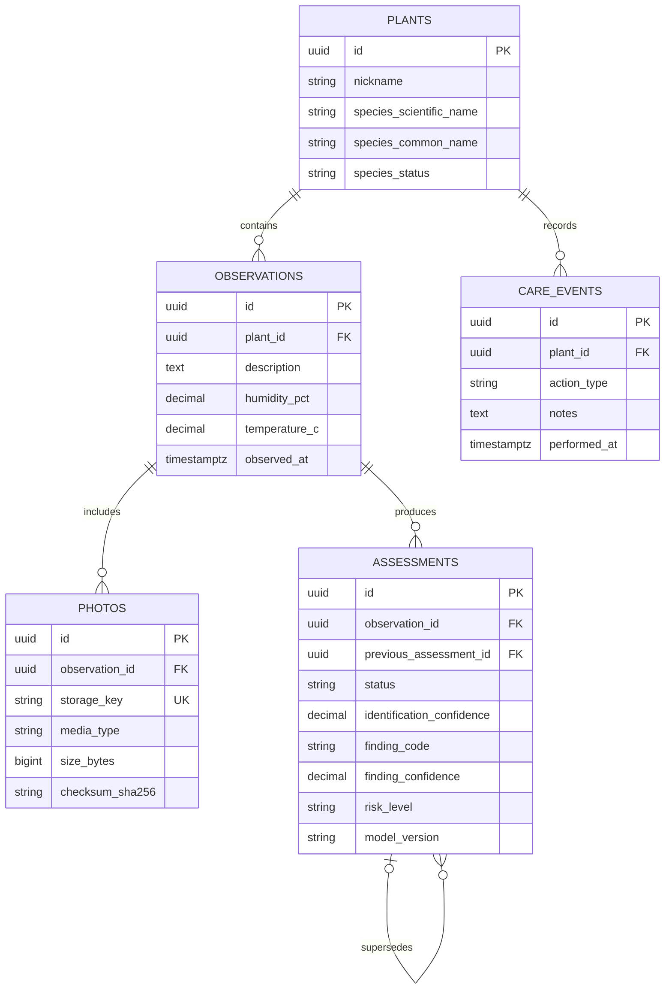

# Модель данных PlantGuard

PostgreSQL хранит долговременное состояние приложения. Изображения размещаются отдельно в объектном хранилище; в таблице `photos` остаются только ключ объекта, контрольная сумма и технические метаданные.



## Инварианты

- вид растения может оставаться неподтверждённым;
- влажность ограничена диапазоном от 0 до 100%, температура — от −50 до 70 °C;
- уверенность моделей хранится в диапазоне от 0 до 1;
- удаление растения каскадно удаляет его наблюдения и события ухода;
- удаление наблюдения удаляет связанные фотографии и оценки;
- удаление предыдущей оценки не удаляет следующую, а очищает ссылку на предшественника;
- ключ фотографии уникален, размер положителен, SHA-256 содержит 64 символа.

Привязка растения к владельцу будет добавлена вместе с пользователями и разграничением доступа на шаге 7.

## Миграции

Применить актуальную схему к локальной базе:

```bash
make db-upgrade
```

Откатить последнюю миграцию в среде разработки:

```bash
make db-downgrade
```

Проверить полный цикл на отдельной одноразовой базе:

```bash
make test-migrations
```

Проверка выполняет применение, сравнение миграции с ORM, вставку связанных записей, каскадное удаление, откат и повторное применение схемы.
